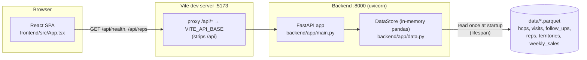

# FS-NAV-001 — Field Force Navigator: Functional / Design Specification

> AI-drafted controlled document (UC2 GxP demo). Synthetic data only; no real GSK systems, people or data.
> Describes the code **as built** at merge commit `20e748e` (PR #8). It does not describe the Territory Call
> Planner features in `docs/uc4/PRD.md`, which are not implemented at this commit; those appear as
> `Not implemented in this change` with a `GAP —` note.

| Field | Value |
|---|---|
| Document ID | FS-NAV-001 |
| Document type | FS |
| Version | 0.1 DRAFT |
| Status | Draft |
| System | Field Force Navigator (`apps/navigator`) |
| GAMP 5 category | 5 (custom application) |
| GxP impact | Indirect: reads synthetic HCP interaction records (visits, follow-ups) that are compliance-relevant. Makes no batch-release, patient-safety or clinical decision (see §11) |
| Change reference | Jira [MBA-3680](https://cog-gtm.atlassian.net/browse/MBA-3680); PR [#8](https://github.com/amitmanchella-cog/gsk-scale-ai-demo/pull/8) "UC4: scaffold Field Force Navigator (FastAPI + React/Vite)", merge commit [`20e748e39c98d163c6d1f6fc2398254b3916d3f4`](https://github.com/amitmanchella-cog/gsk-scale-ai-demo/commit/20e748e39c98d163c6d1f6fc2398254b3916d3f4) |
| Author | Devin (AI-drafted, playbook GxP controlled document from change) |
| Effective date | Set by QA on approval |
| Governing SOPs | SOP-QA-001, SOP-IT-002 |

## Approvals

| Role | Name | Signature meaning | Signature / date |
|---|---|---|---|
| Author | Devin (AI-drafted, playbook GxP controlled document from change) | Authored and technically accurate | |
| System Owner | | Content fit for intended use | |
| Technical Reviewer | | Matches the code and tests at the referenced commit | |
| Quality Assurance | | Complies with SOP-QA-001 and the template | |

> Electronic signatures follow 21 CFR Part 11 §11.50/§11.70 (name, date/time, meaning) in the system of record.
> In this demo the system of record is the Git PR: approval = PR review "Approve" by the named role.
> The AI author does not sign or approve this document (SOP-QA-001 §3).

## 1. Purpose and scope

This FS describes how Field Force Navigator v0.1 (`apps/navigator`, version `0.1.0`) is built at commit `20e748e`,
and how each user requirement in **URS-NAV-001** is met, or not met yet. MBA-3680 introduces the system into the
validated estate. Under SOP-IT-002 §6, "New validated system", it needs four documents: URS-NAV-001, FS-NAV-001
(this document), DRP-NAV-001 and CCR-NAV-001. The other three are drafted in parallel and referenced here by ID only.

**In scope (as built):** the read-only FastAPI backend (`GET /health`, `GET /territories`, `GET /reps`), loading
the curated parquet tables into memory, CORS configuration, and the React/Vite placeholder page (API status and rep
table). Also the automated tests and CI jobs that verify them.

**Not implemented in this change (PRD scope):** Territory HCP list with filters and search, visit priority score,
weekly plan builder (6 visits a day, duplicate and Segment A overdue warnings), CSV export, and the PRD NFRs for
scoring coverage, container build, HCP-list latency and keyboard accessibility. These are listed in §3 and §10 with
`GAP —` notes. No code paths are claimed for them.

**Out of scope (PRD):** CRM integration, real HCP data or PII, SSO, mobile app, route optimisation, GenAI features.

**URS cross-reference.** URS-NAV-001 is drafted in parallel and was not available when this FS was written.
Requirement IDs `URS-NAV-001-Rnn` in this document are **provisional**: they follow the order of PR #8 behaviour,
then PRD features (AC1–AC6), then PRD NFRs. Each row also gives its primary source (PR #8 or PRD §), so the mapping
does not depend on the ID. GAP: the Technical Reviewer reconciles these IDs with the approved URS-NAV-001 before
this FS is approved.

## 2. System overview and architecture

| Component | Runtime | Code path | Responsibility |
|---|---|---|---|
| Backend API | Python 3.11 (CI), FastAPI ≥0.110, pydantic v2, pandas ≥2.0 + pyarrow ≥14, served by uvicorn | `apps/navigator/backend/app/` | Loads the curated tables at startup and serves read-only JSON endpoints |
| Data loader | Python | `apps/navigator/backend/app/data.py` | Resolves the data directory, reads six parquet tables into a `DataStore` |
| Response models | pydantic v2 | `apps/navigator/backend/app/models.py` | `Health`, `Territory`, `Rep` |
| Frontend | Node 20, React 18, Vite 5, TypeScript 5.6 | `apps/navigator/frontend/src/` | Placeholder page: API status, row counts, rep table |
| Curated data (upstream) | Parquet files in Git | `data/*.parquet` (synthetic, seed 42, `data/generate.py`; consumed by UC1 `pipelines/territory_kpis`) | System input; read-only to NAV |

**Deployment unit at this commit:** none packaged. The backend runs with
`uvicorn app.main:app --app-dir apps/navigator/backend` (port 8000). The frontend runs with the Vite dev server
`npm run dev` (port 5173), which proxies `/api/*` to the backend. `npm run build` produces static assets in
`apps/navigator/frontend/dist/`, but nothing at this commit serves them. There is no Dockerfile or container. GAP:
deployment packaging (container, how the SPA is served) is not part of PR #8. DRP-NAV-001 and later FS revisions
must cover it when it is added.

## 3. Functional specification

Implemented functions (verified at `20e748e`):

| Func ID | Function | Behaviour (inputs → outputs, errors) | Implements URS | Code path | Verified by test |
|---|---|---|---|---|---|
| FS-NAV-001-F01 | Health check | `GET /health` → 200 `{"status":"ok","version":"0.1.0","data_dir":<abs path>,"row_counts":{table:int}}` for all six tables. If tables were not loaded yet, they are loaded first (`get_store`) | URS-NAV-001-R01 | `apps/navigator/backend/app/main.py` (`health`, `get_store`); `app/models.py` (`Health`); `app/__init__.py` (`__version__`) | `apps/navigator/backend/tests/test_endpoints.py::test_health_reports_row_counts` |
| FS-NAV-001-F02 | List territories | `GET /territories` → 200, list of `{territory_id, territory_name, region}`, sorted by `territory_id` (20 rows in the synthetic data) | URS-NAV-001-R02 | `app/main.py` (`list_territories`, `_records`); `app/models.py` (`Territory`) | `test_endpoints.py::test_list_territories` |
| FS-NAV-001-F03 | List reps with region | `GET /reps` → 200, list of `{rep_id, rep_name, territory_id, region, hire_date}`, sorted by `rep_id` (30 rows). `region` comes from a left join to `territories` on `territory_id`. Null values become JSON `null` (`region`, `hire_date` optional) | URS-NAV-001-R03 | `app/main.py` (`list_reps`, `_records`); `app/models.py` (`Rep`) | `test_endpoints.py::test_list_reps` |
| FS-NAV-001-F04 | Load curated tables | Startup (`lifespan`) calls `load_tables()`. This resolves the data dir (§7) and reads `hcps, visits, follow_ups, reps, territories, weekly_sales` (`TABLES`) with pandas + pyarrow into `DataStore.tables`. A missing directory or table raises `FileNotFoundError` and the app does not start | URS-NAV-001-R04 | `app/data.py` (`TABLES`, `resolve_data_dir`, `load_tables`, `DataStore`); `app/main.py` (`lifespan`) | `tests/test_data.py::test_load_tables_reads_all_tables`, `test_data.py::test_load_tables_missing_dir`, `test_data.py::test_default_data_dir_is_repo_root_data`, `test_data.py::test_env_override`, `test_data.py::test_relative_override_resolves_against_repo_root` |
| FS-NAV-001-F05 | CORS for the web client | `CORSMiddleware` allows origins from `NAVIGATOR_CORS_ORIGINS` (comma-separated), defaulting to `http://localhost:5173`, `http://127.0.0.1:5173`. All methods and headers, credentials allowed. Preflight from an allowed origin → 200 with `access-control-allow-origin` echoed | URS-NAV-001-R05 | `app/main.py` (`DEFAULT_CORS_ORIGINS`, `cors_origins`, `add_middleware`) | `test_endpoints.py::test_cors_allows_vite_dev_server` |
| FS-NAV-001-F06 | Navigator status page | On mount, `App` calls `fetchHealth()` and `fetchReps()` in parallel through `/api`. It shows the H1 "Field Force Navigator", "API ok", the version, per-table row counts, and a "Reps (n)" table (Rep, Name, Territory, Region; missing region shows "—"). Any non-2xx or network error shows `API unreachable: <message>` | URS-NAV-001-R06 | `apps/navigator/frontend/src/App.tsx`; `src/api.ts` (`API_BASE`, `getJson`, `fetchHealth`, `fetchReps`); `vite.config.ts` (proxy) | `apps/navigator/frontend/src/App.test.tsx::App > renders the title and lists reps from the API`, `App.test.tsx::App > shows an error when the API is unreachable` |

PRD functions **not implemented in this change** (IDs reserved so later revisions keep stable numbering):

| Func ID | Function | Behaviour required (PRD) | Implements URS | Code path | Verified by test |
|---|---|---|---|---|---|
| FS-NAV-001-F07 | Territory HCP list | PRD AC1: for a selected rep, list only that territory's HCPs, with filters for specialty, segment A/B/C and days since last visit, plus name search. **Not implemented in this change** | URS-NAV-001-R07 | GAP: no HCP endpoint or UI at `20e748e` (`hcps` is loaded but not exposed). Specify when implemented | GAP: no test. Add backend + UI tests for AC1 |
| FS-NAV-001-F08 | Visit priority score | PRD AC2/AC3: 0–100 score = segment weight (A=40, B=25, C=10) + days since last visit (+1/day, max 40) + open follow-up (+20), capped at 100. Score is 0 if visited in the last 7 days. Plain-language reason text. **Not implemented in this change** | URS-NAV-001-R08 | GAP: no scoring module at `20e748e`. Specify when implemented | GAP: no test. Add unit tests for AC2 (=100, 3 factors) and AC3 (=0) |
| FS-NAV-001-F09 | Configurable scoring rules | PRD: segment weights, day cap and follow-up bonus are configurable. **Not implemented in this change** | URS-NAV-001-R09 | GAP: no configuration mechanism at `20e748e` | GAP: no test |
| FS-NAV-001-F10 | Weekly plan builder, 6 per day | PRD AC4: add HCPs to Mon–Fri slots. A 7th visit on a day is blocked with a message. **Not implemented in this change** | URS-NAV-001-R10 | GAP: no plan endpoint or UI at `20e748e` | GAP: no test |
| FS-NAV-001-F11 | Duplicate warning | PRD: warn when an HCP is added to the plan more than once. **Not implemented in this change** | URS-NAV-001-R11 | GAP: not implemented at `20e748e` | GAP: no test |
| FS-NAV-001-F12 | Segment A overdue warning | PRD AC5: warn and name any Segment A HCP more than 30 days overdue who is not in the plan. **Not implemented in this change** | URS-NAV-001-R12 | GAP: not implemented at `20e748e` | GAP: no test |
| FS-NAV-001-F13 | CSV export | PRD AC6: export the plan as CSV with day, HCP, specialty, score and reason. **Not implemented in this change** | URS-NAV-001-R13 | GAP: not implemented at `20e748e` | GAP: no test |

## 4. Interfaces (API endpoints, files, external systems)

| Method | Path / interface | Request | Response / errors | Code path |
|---|---|---|---|---|
| GET | `/health` | none | 200 `Health` (`status`, `version`, `data_dir`, `row_counts`). Startup fails if data is missing (§8) | `apps/navigator/backend/app/main.py::health` |
| GET | `/territories` | none | 200 `list[Territory]` (`territory_id`, `territory_name`, `region`) | `app/main.py::list_territories` |
| GET | `/reps` | none | 200 `list[Rep]` (`rep_id`, `rep_name`, `territory_id`, `region?`, `hire_date?` ISO date) | `app/main.py::list_reps` |
| GET | `/docs`, `/openapi.json` | none | FastAPI defaults (Swagger UI / OpenAPI 3 schema), unauthenticated | `app/main.py` (`FastAPI(...)`) |
| OPTIONS | any path (CORS preflight) | `Origin`, `Access-Control-Request-Method` | 200 + CORS headers for allowed origins, 400 for disallowed origins (Starlette default) | `app/main.py` (`CORSMiddleware`) |
| HTTP proxy | Vite dev server `/api/*` | browser request | Forwarded to `VITE_API_BASE` (default `http://localhost:8000`) with `/api` removed | `apps/navigator/frontend/vite.config.ts` |
| File (input) | `<data dir>/{hcps,visits,follow_ups,reps,territories,weekly_sales}.parquet` | read once at startup | `FileNotFoundError` if the directory or any table is missing | `app/data.py::load_tables` |
| External systems | none | | No CRM, SSO, database or third-party API calls (PRD out of scope) | |

Undefined paths return FastAPI's default 404 `{"detail":"Not Found"}`. None of the endpoints take parameters, so
the scaffold has no 422 paths.

## 5. Data model and data flows

**Input tables** (synthetic, seed 42, committed under `data/`). All six are loaded. Only `reps` and `territories`
are exposed at this commit.

| Table | Rows (synthetic) | Columns | Used by |
|---|---|---|---|
| `territories` | 20 | `territory_id`, `territory_name`, `region` | F02, F03 (join) |
| `reps` | 30 | `rep_id`, `rep_name`, `territory_id`, `hire_date` (date) | F03 |
| `hcps` | 1 600 | `hcp_id`, `hcp_name`, `specialty`, `segment`, `territory_id` | row count only (F01). GAP: needed by F07/F08 |
| `visits` | 4 611 | `visit_id`, `hcp_id`, `rep_id`, `territory_id`, `visit_date`, `channel`, `duration_min`, `product` | row count only. GAP: needed by F08 |
| `follow_ups` | 1 393 | `follow_up_id`, `visit_id`, `hcp_id`, `rep_id`, `due_date`, `status`, `note` | row count only. GAP: needed by F08 |
| `weekly_sales` | 2 080 | `territory_id`, `week`, `product`, `units`, `revenue_gbp` | row count only |

**Response models** (`app/models.py`): `Health{status:str, version:str, data_dir:str, row_counts:dict[str,int]}`,
`Territory{territory_id:str, territory_name:str, region:str}`,
`Rep{rep_id:str, rep_name:str, territory_id:str, region:str|None, hire_date:date|None}`. The frontend mirrors
`Health` and `Rep` as TypeScript interfaces in `src/api.ts`.

**Data flow:** `data/*.parquet` → `load_tables()` at startup → in-memory `DataStore` (pandas DataFrames, process
lifetime) → per-request sort/join → `_records()` (NaN → `None`) → pydantic validation → JSON → Vite proxy → React
state → table. The system is **read-only**: no endpoint writes, nothing is persisted, and the source files are
never modified. A change to the data needs a process restart before the API reflects it.

## 6. Security, access control and audit trail

- **Authentication / authorisation:** none. All endpoints, including `/docs`, are anonymous. SSO is out of scope
  in the PRD. Acceptable for v0.1 because the system holds only synthetic, read-only data and has no write paths.
  GAP: reassess before any non-synthetic data or write function (e.g. the PRD plan builder) is introduced.
- **CORS:** allowlist (§3 F05) with `allow_credentials=True`. The origin list is read once when `app.main` is
  imported. Changing `NAVIGATOR_CORS_ORIGINS` needs a restart.
- **Information exposure:** `/health` returns the absolute server path of the data directory (`data_dir`).
  Observation for the Technical Reviewer: harmless in the demo, but it should be reviewed before any shared
  deployment.
- **Audit trail / e-records (Part 11 / Annex 11):** N/A for v0.1. The system creates, modifies and deletes no
  records. Its source records are Git-controlled parquet files, versioned by commit. GAP: an audit trail is needed
  once plans (PRD F10–F13) are persisted.
- **Secrets:** none used or stored. `.env.example` holds only `VITE_API_BASE`. `.env.local` is git-ignored.

## 7. Configuration and environment (env vars, defaults)

| Setting | Where read | Default | Effect |
|---|---|---|---|
| `NAVIGATOR_DATA_DIR` | `app/data.py::resolve_data_dir` (`DATA_DIR_ENV`) | `<repo root>/data`, where repo root = `Path(__file__).resolve().parents[4]` (independent of CWD) | Order: explicit argument > env var > default. Empty string → default. A relative path resolves against the repo root. `~` is expanded |
| `NAVIGATOR_CORS_ORIGINS` | `app/main.py::cors_origins` | `http://localhost:5173,http://127.0.0.1:5173` | Comma-separated allowlist. Blank entries are ignored |
| `VITE_API_BASE` | `frontend/vite.config.ts` (`loadEnv`) | `http://localhost:8000` | Target for the dev-server `/api` proxy |
| `API_BASE` (constant) | `frontend/src/api.ts` | `/api` | Prefix for every frontend fetch |
| Version | `backend/app/__init__.py` (`__version__`), `frontend/package.json` | `0.1.0` | Reported by `/health` and shown in the UI |
| Ports | uvicorn / `vite.config.ts` (`server.port`) | 8000 / 5173 | Local runtime |

Dependencies: `apps/navigator/backend/requirements.txt` (fastapi ≥0.110, uvicorn ≥0.29, pandas ≥2.0, pyarrow ≥14,
pydantic ≥2.6, httpx ≥0.27, pytest ≥8; lower bounds only, not pinned) and
`apps/navigator/frontend/package.json` + committed `package-lock.json` (Node ≥20; installed with `npm ci`).
GAP: backend dependencies are not pinned, so builds are not fully reproducible. Track this in CCR-NAV-001 or a
later change.

## 8. Error handling and logging

| Condition | Behaviour | Code path |
|---|---|---|
| Data directory missing | `FileNotFoundError("navigator data directory not found: <path>")` raised in `lifespan`. uvicorn does not start the app | `app/data.py::load_tables` |
| One table missing | `FileNotFoundError("missing curated table '<name>': <path>")`. App does not start | `app/data.py::load_tables` |
| Store not initialised (e.g. app used without lifespan) | `get_store()` loads the tables lazily on first request | `app/main.py::get_store` |
| Null values in data | Converted to `None` / JSON `null` by `_records` | `app/main.py::_records` |
| Unknown route | 404 `{"detail":"Not Found"}` (FastAPI default) | framework |
| Unhandled exception | 500 (Starlette default). No custom handler | framework |
| Frontend: non-2xx response | `getJson` throws `"<path> failed with HTTP <status>"`. UI shows `API unreachable: <message>` | `frontend/src/api.ts`, `src/App.tsx` |
| Frontend: unmounted during fetch | `cancelled` flag prevents state updates | `src/App.tsx` |

Logging: no application logging is configured. Only uvicorn's default access and error logs go to stdout. GAP:
structured logging and log retention are not defined. Address them with deployment (see DRP-NAV-001).

## 9. Test strategy (unit / integration / UI; CI job names)

| Level | Tool | Tests at `20e748e` | Location |
|---|---|---|---|
| Unit (data loader) | pytest | 5: `test_default_data_dir_is_repo_root_data`, `test_env_override`, `test_relative_override_resolves_against_repo_root`, `test_load_tables_missing_dir`, `test_load_tables_reads_all_tables` | `apps/navigator/backend/tests/test_data.py` |
| Integration (API) | pytest + FastAPI `TestClient` (real synthetic data, lifespan run) | 4: `test_health_reports_row_counts`, `test_list_reps`, `test_list_territories`, `test_cors_allows_vite_dev_server` | `apps/navigator/backend/tests/test_endpoints.py` |
| UI component | vitest 2 + Testing Library (jsdom, `fetch` mocked) | 2: "renders the title and lists reps from the API", "shows an error when the API is unreachable" | `apps/navigator/frontend/src/App.test.tsx` |
| Static | ruff (`E,F,I,W`, line 120), ESLint 9 (typescript-eslint, react-hooks), `tsc -b` | — | `pyproject.toml`, `frontend/eslint.config.js`, `frontend/tsconfig*.json` |

Test harness note: `tests/conftest.py` loads the backend package under the alias `navigator_app` (importlib). This
avoids a clash with the `app` package of `services/supply_api` when root `pytest` runs both suites in one process.

CI (`.github/workflows/ci.yml`, on every PR and push to `main`):
- `python`, "Python lint + tests (data, pipelines, services)": `ruff check .`, `pytest` (testpaths include
  `apps`; installs `apps/*/backend/requirements.txt`).
- `navigator-frontend`, "Navigator frontend (lint, test, build)": Node 20, `npm ci`, `npm run lint`,
  `npm test -- --run`, `npm run build`.

Evidence at the merge commit: both check runs passed on `20e748e`
([Actions run 41018019513](https://github.com/amitmanchella-cog/gsk-scale-ai-demo/actions/runs/41018019513)).
A local re-run while drafting gave `pytest apps/navigator/backend` → `9 passed`.

Not covered: no container build job (PRD NFR) and no performance or accessibility tests. The CI job for the
frontend is named `navigator-frontend`; ESTATE_MAP §2 lists it as `frontend` (editorial discrepancy in the
baseline, for the System Owner to correct there).

## 10. Traceability matrix

| Req ID | Requirement (short) | Source (ticket / PRD §) | Design ref | Code path(s) | Test(s) | Change ref (ticket / PR) | Status |
|---|---|---|---|---|---|---|---|
| URS-NAV-001-R01 | API health and data row counts | MBA-3680; PR #8 description | FS-NAV-001-F01, §4 | `apps/navigator/backend/app/main.py` (`health`, `get_store`), `app/models.py` (`Health`) | `backend/tests/test_endpoints.py::test_health_reports_row_counts` | MBA-3680 / PR #8 (`20e748e`) | Implemented, verified (CI green) |
| URS-NAV-001-R02 | List territories | MBA-3680; PR #8; PRD §Data (territories) | FS-NAV-001-F02, §4 | `app/main.py` (`list_territories`), `app/models.py` (`Territory`) | `test_endpoints.py::test_list_territories` | MBA-3680 / PR #8 | Implemented, verified |
| URS-NAV-001-R03 | List reps with region (rep selection basis) | MBA-3680; PR #8; PRD §Users / AC1 precondition | FS-NAV-001-F03, §4 | `app/main.py` (`list_reps`), `app/models.py` (`Rep`) | `test_endpoints.py::test_list_reps` | MBA-3680 / PR #8 | Implemented, verified |
| URS-NAV-001-R04 | Use UC1 curated synthetic tables; configurable location; fail on missing data | PRD §Data; PR #8 | FS-NAV-001-F04, §5, §7, §8 | `app/data.py` (`resolve_data_dir`, `load_tables`), `app/main.py` (`lifespan`) | `test_data.py::test_load_tables_reads_all_tables`, `::test_load_tables_missing_dir`, `::test_default_data_dir_is_repo_root_data`, `::test_env_override`, `::test_relative_override_resolves_against_repo_root` | MBA-3680 / PR #8 | Implemented, verified |
| URS-NAV-001-R05 | Browser client may call the API (CORS allowlist) | PR #8 | FS-NAV-001-F05, §6, §7 | `app/main.py` (`cors_origins`, `CORSMiddleware`) | `test_endpoints.py::test_cors_allows_vite_dev_server` | MBA-3680 / PR #8 | Implemented, verified |
| URS-NAV-001-R06 | Web page shows API status and rep list; error if API unreachable | PR #8 | FS-NAV-001-F06, §2 | `frontend/src/App.tsx`, `frontend/src/api.ts`, `frontend/vite.config.ts` | `frontend/src/App.test.tsx::renders the title and lists reps from the API`, `::shows an error when the API is unreachable` | MBA-3680 / PR #8 | Implemented, verified |
| URS-NAV-001-R07 | Territory HCP list with filters and search | PRD §In scope 1; AC1 | FS-NAV-001-F07 | GAP: not implemented at `20e748e`. Implement HCP endpoint + UI | GAP: add AC1 tests | MBA-3680 / PR #8 (not delivered) | Not implemented in this change |
| URS-NAV-001-R08 | Visit priority score 0–100 with reason | PRD §In scope 2; AC2, AC3 | FS-NAV-001-F08 | GAP: not implemented at `20e748e`. Implement scoring module | GAP: add AC2/AC3 unit tests | MBA-3680 / PR #8 (not delivered) | Not implemented in this change |
| URS-NAV-001-R09 | Scoring rules configurable | PRD §In scope 2 | FS-NAV-001-F09 | GAP: not implemented at `20e748e` | GAP: add config tests | MBA-3680 / PR #8 (not delivered) | Not implemented in this change |
| URS-NAV-001-R10 | Weekly plan Mon–Fri, max 6 visits/day | PRD §In scope 3; AC4 | FS-NAV-001-F10 | GAP: not implemented at `20e748e` | GAP: add AC4 tests | MBA-3680 / PR #8 (not delivered) | Not implemented in this change |
| URS-NAV-001-R11 | Duplicate-in-plan warning | PRD §In scope 3 | FS-NAV-001-F11 | GAP: not implemented at `20e748e` | GAP: add duplicate-warning test | MBA-3680 / PR #8 (not delivered) | Not implemented in this change |
| URS-NAV-001-R12 | Segment A > 30 days overdue warning naming the HCP | PRD §In scope 3; AC5 | FS-NAV-001-F12 | GAP: not implemented at `20e748e` | GAP: add AC5 tests | MBA-3680 / PR #8 (not delivered) | Not implemented in this change |
| URS-NAV-001-R13 | CSV export (day, HCP, specialty, score, reason) | PRD §In scope 3; AC6 | FS-NAV-001-F13 | GAP: not implemented at `20e748e` | GAP: add AC6 tests | MBA-3680 / PR #8 (not delivered) | Not implemented in this change |
| URS-NAV-001-R14 | Scoring logic ≥ 90% unit test coverage | PRD §Non-functional | §9 | GAP: no scoring code at `20e748e` | GAP: add coverage gate once F08 exists | MBA-3680 / PR #8 (not delivered) | Not implemented in this change |
| URS-NAV-001-R15 | CI runs lint, tests and a container build on every PR | PRD §Non-functional | §9 | `.github/workflows/ci.yml` (jobs `python`, `navigator-frontend`). GAP: no container build job or Dockerfile | `python` + `navigator-frontend` CI jobs (run 41018019513). GAP: container build not tested | MBA-3680 / PR #8 | Partially implemented: lint + tests yes, container build not implemented in this change |
| URS-NAV-001-R16 | HCP list loads < 1 s for 300 HCPs | PRD §Non-functional | §3 F07 | GAP: no HCP list at `20e748e` | GAP: add performance test with F07 | MBA-3680 / PR #8 (not delivered) | Not implemented in this change |
| URS-NAV-001-R17 | Basic keyboard accessibility | PRD §Non-functional | §3 F06 | `frontend/src/App.tsx` (static semantic HTML: `h1`/`h2`, `table`, `section aria-label`; no interactive controls). GAP: no keyboard-interaction design | GAP: no accessibility test | MBA-3680 / PR #8 (not delivered) | Not implemented in this change |

## 11. Impact on validated state

- **Validated state before change:** none. Field Force Navigator is a new system and had no controlled documents
  (ESTATE_MAP §4: URS/FS/DRP/CCR missing). After approval, the validated baseline is v0.1.0 at `20e748e` with
  URS-NAV-001, FS-NAV-001, DRP-NAV-001 and CCR-NAV-001.
- **Components affected:** all new. `apps/navigator/backend/app/{__init__,data,main,models}.py`,
  `apps/navigator/backend/requirements.txt`, `apps/navigator/backend/tests/*`, `apps/navigator/frontend/**`
  (incl. `package-lock.json`), the `navigator-frontend` job in `.github/workflows/ci.yml`, and
  `apps/navigator/README.md`. Upstream input `data/*.parquet` is read only, not changed.
- **GxP impact assessment:** Indirect. The system displays synthetic rep and territory reference data and counts of
  HCP interaction records. It does not support batch release, patient safety or clinical decisions, and does not
  create or change records.
- **Data integrity (ALCOA+) impact:** Attributable: N/A (no users or writes). Legible/Accurate: values served
  unchanged from the source parquet, verified against known counts (30 reps, 20 territories, 1 600 HCPs) by tests.
  Contemporaneous/Original/Enduring: the source of truth is Git-versioned parquet. The API holds an in-memory copy
  only. Consistent: deterministic sort order (`rep_id`, `territory_id`). No new data-integrity risk.
- **Part 11 / Annex 11 controls affected:** audit trail N/A (no records created or changed). E-signatures N/A in
  the application (PR approvals are the e-signature for documents). Access control: none (synthetic data, §6 GAP).
  Backups: code and data are in Git; recovery is covered by DRP-NAV-001.
- **Revalidation required:** Full initial validation, because this is a new system (SOP-IT-002 §6). Evidence: 9
  backend and 2 frontend automated tests plus lint/type-check/build, green in CI on `20e748e`. Implementing any
  `Not implemented in this change` function (F07–F13) is a new user-facing function. It needs URS/FS updates and a
  new CCR (SOP-IT-002 §6).
- **Other controlled documents to update:** URS-NAV-001 (reconcile provisional requirement IDs, §1), DRP-NAV-001
  (no deployment unit at this commit, §2), CCR-NAV-001 (record this FS as v0.1 DRAFT and the dependency-pinning
  gap, §7). Baseline ESTATE_MAP §2 CI job name `frontend` → `navigator-frontend` (editorial, owner: System Owner).

## 12. Revision history

| Version | Date | Author | Change reference | Description |
|---|---|---|---|---|
| 0.1 DRAFT | 2026-10-30 | Devin (AI-drafted, playbook GxP controlled document from change) | MBA-3680 / PR #8 (merge `20e748e`) | First draft: as-built FS of Navigator v0.1 scaffold; PRD features recorded as not implemented with GAP notes |
