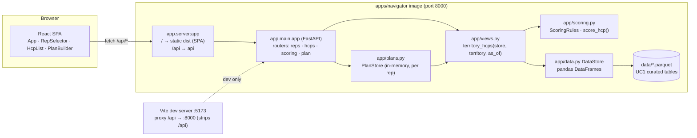

# Design — Field Force Navigator: Territory Call Planner (MBA-3650)

| | |
|---|---|
| Jira | [MBA-3650](https://cog-gtm.atlassian.net/browse/MBA-3650) — sub-tasks MBA-3659 (S1) … MBA-3663 (S5) |
| Phase | 2 — Design (approver: Tech Lead). Phase 1 `docs/uc4/requirements.md` approved by the Product Owner. |
| App | `apps/navigator/` — FastAPI + pandas backend (package `app`), React 18 / Vite 5 / TypeScript frontend |
| Status | Draft — awaiting "APPROVED" on the Jira comment |

## 1. Design goals

1. **Keep the scaffold's shape** (PR #8): one FastAPI package `app` with relative imports, one Vite SPA calling
   `/api`, UC1 parquet tables loaded into pandas at startup. No database, no new infrastructure.
2. **Scoring is a pure, dependency-free module** (`app/scoring.py`) so the ≥ 90% coverage gate is cheap and the rules
   are testable without data.
3. **All plan rules live in the backend** (cap, duplicates, overdue warnings, CSV) so the API alone satisfies
   AC4–AC6 and the UI is a thin, keyboard-accessible view.
4. **One image** serves API + SPA + data for UC3 and the non-prod deploy; local dev is unchanged.

## 2. Architecture



- **Dev**: `uvicorn app.main:app` on :8000 and `vite` on :5173 exactly as today; the Vite proxy strips `/api`.
- **Container / non-prod**: `uvicorn app.server:app`. `app/server.py` builds an outer FastAPI that mounts
  `app.main:app` at `/api` and the built SPA (`frontend/dist`, `StaticFiles(html=True)`) at `/`, plus a root
  `/health` passthrough for container smoke tests. Nothing in `app.main` changes between the two modes.
- **Runtime config** (env vars, all optional): `NAVIGATOR_DATA_DIR`, `NAVIGATOR_AS_OF_DATE` (default: latest
  `visit_date` in the data), `NAVIGATOR_SCORING_RULES` (JSON) or `NAVIGATOR_SCORING_RULES_FILE`,
  `NAVIGATOR_MAX_VISITS_PER_DAY` (6), `NAVIGATOR_CORS_ORIGINS`.

### Backend module layout (after the build)

```
apps/navigator/backend/app/
├── __init__.py        __version__ = "0.2.0"
├── main.py            FastAPI app, lifespan, CORS, include_router(...) for the four routers
├── server.py          outer app for the container: /api -> main.app, / -> SPA
├── data.py            DataStore (unchanged) + as_of resolution
├── scoring.py         ScoringRules, ScoreFactor, ScoreResult, score_hcp(), load_rules()
├── views.py           territory_hcps(): HCPs + last visit + days since + open follow-ups + score
├── plans.py           Day enum, PlanVisit, Plan, PlanStore, warnings, to_csv()
├── models.py          pydantic response/request models
└── routers/
    ├── reps.py        GET /reps, GET /territories (moved from main.py)
    ├── hcps.py        GET /reps/{rep_id}/hcps
    ├── scoring.py     GET /scoring/rules, GET /scoring/explain
    └── plan.py        GET/POST/DELETE /reps/{rep_id}/plan…, GET …/plan/export.csv
```

### Frontend component layout

```
apps/navigator/frontend/src/
├── App.tsx            layout: header, RepSelector, two-column HcpList | PlanBuilder, status bar
├── api.ts             typed fetch helpers for every endpoint (+ request/response types)
├── components/
│   ├── RepSelector.tsx    <select> of 30 reps (label "Rep")
│   ├── HcpList.tsx        filters (specialty, segment, min days), search, "Adding to" day picker, table
│   ├── PlanBuilder.tsx    Mon–Fri columns (n/6), Remove buttons, Warnings (role="alert"), Export CSV link
│   └── Warnings.tsx       list of warnings, aria-live="polite"
└── *.test.tsx         vitest + Testing Library component tests (fetch mocked)
```

## 3. Data model

### Source tables (UC1, read-only)

```mermaid
erDiagram
  territories ||--o{ reps : has
  territories ||--o{ hcps : contains
  hcps ||--o{ visits : receives
  reps ||--o{ visits : makes
  visits ||--o{ follow_ups : spawns
  territories { string territory_id PK; string territory_name; string region }
  reps { string rep_id PK; string rep_name; string territory_id FK; date hire_date }
  hcps { string hcp_id PK; string hcp_name; string specialty; string segment; string territory_id FK }
  visits { string visit_id PK; string hcp_id FK; string rep_id FK; string territory_id; date visit_date; string channel; int duration_min; string product }
  follow_ups { string follow_up_id PK; string visit_id FK; string hcp_id FK; string rep_id FK; date due_date; string status; string note }
```

Row counts: 20 territories, 30 reps, 1,600 HCPs (59–101 per territory), 4,611 visits (2025-04-01 → 2025-09-29),
1,393 follow-ups (567 `open`). `weekly_sales` is loaded by the scaffold but unused here.

### Derived model (computed in memory per request)

```mermaid
classDiagram
  class HcpView {
    hcp_id, hcp_name, specialty, segment, territory_id
    last_visit_date: date | null
    days_since_last_visit: int | null
    open_follow_ups: int
    score: int (0-100)
    reason: str
    factors: ScoreFactor[]
  }
  class ScoreFactor { name: str; points: int; detail: str }
  class ScoringRules {
    segment_weights = {A:40,B:25,C:10}
    points_per_day = 1
    days_cap = 40
    open_follow_up_bonus = 20
    recent_visit_days = 7
    max_score = 100
  }
  class Plan {
    rep_id, territory_id, week_start: date, as_of: date
    days: PlanDay[5]
    warnings: Warning[]
    total_visits: int
    max_visits_per_day: int
  }
  class PlanDay { day: Mon|Tue|Wed|Thu|Fri; date; visits: PlanVisit[]; count; capacity }
  class PlanVisit { visit_id: int; hcp_id; hcp_name; specialty; segment; score; reason }
  class Warning { type: overdue_segment_a | duplicate; hcp_id; hcp_name; days: str[]; message }
  HcpView --> ScoreFactor
  Plan --> PlanDay --> PlanVisit
  Plan --> Warning
```

`territory_hcps(store, territory_id, as_of, rules)` (in `views.py`) does the joins once per request with pandas:
`hcps[territory] ⟕ max(visit_date) by hcp ⟕ count(open follow_ups) by hcp`, then applies `score_hcp` row-wise.
For ≤ 101 HCPs this is ~5 ms; the S5.3 perf test checks 300 HCPs in < 1 s.

**PlanStore** is a process-local `dict[rep_id, Plan]` guarded by a lock. Plans are rebuilt against the current
`HcpView` on every read so scores/warnings follow the as-of date and rules (not frozen at add time). The visit list
per day is ordered by insertion; `visit_id` is a per-plan counter so duplicates (S3.1) can be removed individually.

## 4. API contract

All endpoints are JSON unless stated; errors use FastAPI's `{"detail": "..."}`. In dev the SPA calls them under
`/api` (proxy strips it); in the container they are mounted under `/api`.

| Method | Path | Query / body | 200 response | Errors |
|---|---|---|---|---|
| GET | `/health` | — | `Health` (+ `as_of`) | — |
| GET | `/reps` | — | `Rep[]` (unchanged) | — |
| GET | `/territories` | — | `Territory[]` (unchanged) | — |
| GET | `/scoring/rules` | — | `ScoringRules` in effect | — |
| GET | `/scoring/explain` | `segment=A\|B\|C`, `days_since_last_visit=int\|null`, `open_follow_ups=int` | `ScoreResult {score, reason, factors}` | 422 invalid segment |
| GET | `/reps/{rep_id}/hcps` | `specialty?`, `segment?`, `min_days_since_last_visit?`, `q?`, `as_of?` | `HcpListResponse {rep, territory, as_of, count, hcps: HcpView[]}` sorted score desc, name asc | 404 unknown rep |
| GET | `/reps/{rep_id}/plan` | `as_of?` | `Plan` | 404 unknown rep |
| POST | `/reps/{rep_id}/plan/visits` | body `{"hcp_id": "H00052", "day": "Tue"}` | `201 Plan` | 404 rep/hcp; 409 day full; 422 bad day / HCP outside territory |
| DELETE | `/reps/{rep_id}/plan/visits/{visit_id}` | — | `Plan` | 404 |
| DELETE | `/reps/{rep_id}/plan` | — | empty `Plan` | 404 |
| GET | `/reps/{rep_id}/plan/export.csv` | — | `text/csv; charset=utf-8`, `Content-Disposition: attachment; filename="plan_R001_2025-09-29.csv"` | 404 |

Examples:

```http
GET /reps/R001/hcps?segment=A&min_days_since_last_visit=30&q=xu
200 {"rep": {"rep_id": "R001", "rep_name": "Dev Okafor", "territory_id": "T001"},
     "territory": {"territory_id": "T001", "territory_name": "South-01", "region": "South"},
     "as_of": "2025-09-29", "count": 1,
     "hcps": [{"hcp_id": "H00052", "hcp_name": "Dr Chloe Xu", "specialty": "Pulmonology", "segment": "A",
               "territory_id": "T001", "last_visit_date": "2025-07-31", "days_since_last_visit": 60,
               "open_follow_ups": 1, "score": 100,
               "reason": "Segment A (+40), 60 days since last visit (+40, capped), 1 open follow-up (+20)",
               "factors": [{"name": "segment", "points": 40, "detail": "Segment A"},
                           {"name": "days_since_last_visit", "points": 40, "detail": "60 days since last visit (capped)"},
                           {"name": "open_follow_up", "points": 20, "detail": "1 open follow-up"}]}]}

POST /reps/R001/plan/visits  {"hcp_id": "H00052", "day": "Tue"}
409 {"detail": "Tuesday already has 6 visits (max 6)"}

POST /reps/R001/plan/visits  {"hcp_id": "H00002", "day": "Tue"}      # H00002 is in T005
422 {"detail": "HCP H00002 is not in territory T001"}

GET /reps/R001/plan
200 {"rep_id": "R001", "territory_id": "T001", "week_start": "2025-09-29", "as_of": "2025-09-29",
     "max_visits_per_day": 6, "total_visits": 2,
     "days": [{"day": "Mon", "date": "2025-09-29", "count": 1, "capacity": 6,
               "visits": [{"visit_id": 1, "hcp_id": "H00052", "hcp_name": "Dr Chloe Xu", "specialty": "Pulmonology",
                           "segment": "A", "score": 100, "reason": "Segment A (+40), …"}]},
              {"day": "Tue", "date": "2025-09-30", "count": 1, "capacity": 6, "visits": [{"visit_id": 2, "hcp_id": "H00052", …}]},
              {"day": "Wed", …}, {"day": "Thu", …}, {"day": "Fri", …}],
     "warnings": [{"type": "duplicate", "hcp_id": "H00052", "hcp_name": "Dr Chloe Xu", "days": ["Mon", "Tue"],
                   "message": "Dr Chloe Xu is planned twice (Mon, Tue)"},
                  {"type": "overdue_segment_a", "hcp_id": "H00066", "hcp_name": "Dr Finn Singh", "days": [],
                   "message": "Dr Finn Singh (Segment A) is 57 days overdue and not planned"}]}
```

CSV (AC6 / S4): header `day,hcp_id,hcp_name,specialty,segment,score,reason`; rows Mon→Fri, score desc within a
day; written with Python `csv` (RFC 4180 quoting, so the comma-separated reason is quoted); `\r\n` line endings;
header only for an empty plan.

## 5. Scoring design and worked examples

```python
@dataclass(frozen=True)
class ScoringRules:
    segment_weights: dict[str, int] = {"A": 40, "B": 25, "C": 10}
    points_per_day: int = 1
    days_cap: int = 40
    open_follow_up_bonus: int = 20
    recent_visit_days: int = 7
    max_score: int = 100

def score_hcp(segment, days_since_last_visit: int | None, open_follow_ups: int, rules=DEFAULT_RULES) -> ScoreResult
```

Algorithm (pure function, no I/O):

1. If `days_since_last_visit is not None and days ≤ recent_visit_days` → `score 0`, single factor
   `recent_visit`, reason `"Visited {days} days ago (within {recent_visit_days} days)"`. Stop.
2. `segment` factor: `segment_weights[segment]`, detail `"Segment A"`.
3. `days` factor: `None` → `days_cap`, detail `"never visited (+cap)"`; else `min(days × points_per_day, days_cap)`,
   detail `"{days} days since last visit"` + `" (capped)"` when the cap applied.
4. `open_follow_up` factor: `open_follow_up_bonus` if `open_follow_ups ≥ 1`, detail `"{n} open follow-up(s)"`;
   omitted when 0 (no "+0" factors, S2.2).
5. `score = min(sum(points), max_score)`; reason = factors joined by `", "`, each as `"{detail} (+{points})"`;
   when capped at 100 the reason ends with `" → capped at 100"`.

Rules are loaded once at startup by `load_rules()`: `NAVIGATOR_SCORING_RULES` (JSON object with any subset of the
fields) > `NAVIGATOR_SCORING_RULES_FILE` > defaults; validated by a pydantic model (weights for A/B/C required,
non-negative ints). `GET /scoring/rules` returns them; `GET /scoring/explain` scores arbitrary inputs so AC2/AC3 can be
demonstrated live without hunting for a matching HCP.

| Case | Inputs | Factors | Score | Reason |
|---|---|---|---|---|
| **AC2** | A, 45 days, 1 open | 40 + min(45, 40)=40 + 20 = 100 | **100** | `Segment A (+40), 45 days since last visit (+40, capped), 1 open follow-up (+20)` |
| **AC3** | any, 3 days, any | recent visit | **0** | `Visited 3 days ago (within 7 days)` |
| S2.1 | B, never visited, 0 open | 25 + 40 = 65 | 65 | `Segment B (+25), never visited (+40, capped)` |
| S2.2 | C, 12 days, 0 open | 10 + 12 = 22 | 22 | `Segment C (+10), 12 days since last visit (+12)` |
| Boundary | A, 7 days, 2 open | recent visit (7 ≤ 7) | 0 | `Visited 7 days ago (within 7 days)` |
| Boundary | A, 8 days, 0 open | 40 + 8 = 48 | 48 | `Segment A (+40), 8 days since last visit (+8)` |
| Cap only | A, 40 days, 0 open | 40 + 40 = 80 | 80 | `… 40 days since last visit (+40)` (no "capped": 40 × 1 = cap exactly) |
| Over 100 | A, 60 days, 1 open | 40 + 40 + 20 = 100 | 100 | ends `(+20) → capped at 100` only if raw > 100; here raw = 100, so no suffix |
| Real data | H00052 Dr Chloe Xu (T001): A, 60 days, 1 open | 100 | 100 | as in the API example above |
| Real data | H00011 Dr Rhea Okafor: visited 5 days ago | recent | 0 | `Visited 5 days ago (within 7 days)` |
| Custom rules | `{"segment_weights":{"A":50,"B":25,"C":10}}`, A, 10 days, 0 open | 50 + 10 | 60 | `Segment A (+50), 10 days since last visit (+10)` |

Plan warnings (`plans.py`):

- `overdue_segment_a`: for each `HcpView` in the territory with `segment == "A"` and
  (`days_since_last_visit is None or > 30`) whose `hcp_id` is on no day → one warning
  `"{name} (Segment A) is {days} days overdue and not planned"` (`"has never been visited"` when `None`). Ordered by
  days desc. Threshold `30` is `overdue_days` in the plan settings (env `NAVIGATOR_OVERDUE_DAYS`, default 30).
- `duplicate`: for each `hcp_id` appearing more than once across the week → `"{name} is planned twice (Mon, Tue)"`
  (`"3 times"` etc.).
- Cap: `POST` with `len(day.visits) ≥ max_visits_per_day` → `409 "Tuesday already has 6 visits (max 6)"`; the plan
  is not modified. Checked before the duplicate logic, so a 7th duplicate is still a 409.

Worked AC5 example on repo data, rep R001 (T001, 64 HCPs, 15 Segment A, 12 of them > 30 days overdue or never
visited as of 2025-09-29): an empty plan shows 12 `overdue_segment_a` warnings; adding Dr Chloe Xu to any day drops
it to 11 and her warning disappears.

## 6. Frontend design

- **State**: `selectedRepId`, `filters {specialty, segment, minDays, q}`, `addDay` (Mon default), `hcps`
  (`HcpListResponse`), `plan` (`Plan`), `message` (last blocked/error message). Fetch `/reps/{id}/hcps` when rep or
  filters change (search is debounced 200 ms); refetch `/reps/{id}/plan` after every mutation (the mutation response
  is the new plan, so no extra round trip).
- **HcpList**: `<label>`ed `<select>`s for specialty/segment, `<input type="number">` for min days, `<input
  type="search">` for name; a day picker "Add to: [Mon]"; table rows with an "Add" button whose accessible name is
  `Add {hcp_name} to {Monday}`. Score cell shows the number with the reason as visible text (not only a tooltip).
- **PlanBuilder**: five `<section aria-labelledby>` columns titled `Monday 3/6`, each visit with a `Remove {name}
  from Monday` button; a 409 shows `message` in a `role="alert"` box next to the day picker; warnings render in
  `<ul aria-live="polite">`; Export is `<a href="/api/reps/R001/plan/export.csv" download>` styled as a button
  (disabled state when the plan is empty).
- **Keyboard (S5.4)**: only native controls (`select`, `input`, `button`, `a`), visible `:focus-visible` outline,
  logical DOM order (selector → filters → list → plan), no mouse-only handlers.
- **Performance (S5.3)**: the list is a plain table (max 101 rows on this data; 300 in the perf test is still fine
  without virtualisation).

## 7. Packaging and CI (S5)

`apps/navigator/Dockerfile` (multi-stage):

```dockerfile
FROM node:20-alpine AS web
WORKDIR /web
COPY apps/navigator/frontend/package*.json ./
RUN npm ci
COPY apps/navigator/frontend ./
RUN npm run build                                   # -> /web/dist

FROM python:3.11-slim
WORKDIR /srv
COPY apps/navigator/backend/requirements.txt ./
RUN pip install --no-cache-dir -r requirements.txt
COPY apps/navigator/backend/app ./app
COPY data/*.parquet ./data/
COPY --from=web /web/dist ./static
ENV NAVIGATOR_DATA_DIR=/srv/data NAVIGATOR_STATIC_DIR=/srv/static PORT=8000
EXPOSE 8000
HEALTHCHECK CMD python -c "import urllib.request;urllib.request.urlopen('http://127.0.0.1:8000/health')"
CMD ["uvicorn", "app.server:app", "--host", "0.0.0.0", "--port", "8000"]
```

Build context is the repo root (`docker build -f apps/navigator/Dockerfile .`) because the image needs `data/`.

CI (`.github/workflows/ci.yml`) adds two things: the Python job runs
`pytest apps/navigator/backend --cov=app.scoring --cov-report=term --cov-fail-under=90` (via the alias in
`conftest.py`, i.e. `--cov=navigator_app.scoring`) in addition to the whole-repo `pytest`, and a new
`navigator-container` job runs `docker build`, starts the container, and curls `/health` and `/api/reps`. All three
jobs are required for the PR.

Release (phase 5): `.github/workflows/deploy-navigator.yml` — `workflow_dispatch` + push to `main` touching
`apps/navigator/**`, job `deploy` with `environment: non-prod` (required reviewer = Amit), builds the image, pushes
`ghcr.io/amitmanchella-cog/gsk-scale-ai-demo/navigator:{sha,latest}` (there is no cloud target in this repo), and
runs a smoke test against the pushed image. Details confirmed in phase 5.

## 8. Build plan (phase 3)

Branch `devin/MBA-3650` (already holds the docs). One child session per story, each on its own branch
`devin/MBA-3650-s<N>` branched from `devin/MBA-3650`, opening a PR **into** `devin/MBA-3650`; the parent session
reviews, merges (squash), and finally opens the single PR `devin/MBA-3650 → main` that links MBA-3650 and the docs.

| Order | Story | Child branch | Touches | Notes |
|---|---|---|---|---|
| 0 | foundation (parent) | `devin/MBA-3650` | `routers/` split, `as_of` in `DataStore`/`/health`, `api.ts` types, empty `components/` | small, avoids merge conflicts between children |
| 1 | S2 scoring + `views.py` | `devin/MBA-3650-s2` | `scoring.py`, `views.py`, `routers/scoring.py`, `test_scoring.py`, `test_views.py` | first: S1/S3 depend on it |
| 2a | S1 HCP list | `devin/MBA-3650-s1` | `routers/hcps.py`, `models.py`, `HcpList.tsx`, `RepSelector.tsx`, `App.tsx` (left column) | parallel with 2b |
| 2b | S3 plan builder | `devin/MBA-3650-s3` | `plans.py`, `routers/plan.py`, `PlanBuilder.tsx`, `Warnings.tsx`, `App.tsx` (right column) | parallel with 2a; `App.tsx` conflict resolved by parent |
| 3a | S4 CSV export | `devin/MBA-3650-s4` | `plans.py::to_csv`, `routers/plan.py` export route, Export link | after S3 |
| 3b | S5 packaging/CI/NFR | `devin/MBA-3650-s5` | `server.py`, `Dockerfile`, `ci.yml`, `test_perf.py`, `a11y.test.tsx`, READMEs | after S1–S3; parallel with S4 |

Each child must: use the test IDs from the requirements traceability matrix, keep `ruff check .`, `pytest`,
`npm run lint`, `npm test -- --run`, `npm run build` green, and not touch files outside its row without saying so.

## 9. Test plan

| Level | Tool | What | Gate |
|---|---|---|---|
| Unit — scoring | pytest, `pytest-cov` | `test_scoring.py`: AC2, AC3, S2.1, S2.2, boundaries (7/8 days, cap at 40, cap at 100), rules from env/file, invalid rules rejected | `--cov=app.scoring --cov-fail-under=90` |
| Unit — views/plans | pytest | `test_views.py` (joins, never-visited, open follow-up count on a 6-row fixture), `test_plan.py` (AC4, AC5, S3.1–S3.4), `test_export.py` (AC6, S4.1, S4.2) | CI |
| API | pytest + `TestClient` | `test_hcps.py` (AC1 filters/search/404/sort), `test_scoring_api.py` (`/scoring/rules`, `/scoring/explain`), plan endpoints on repo data | CI |
| Performance | pytest | `test_perf.py`: synthetic territory of 300 HCPs via a temp `NAVIGATOR_DATA_DIR`; p95 of 5 calls to `/reps/{id}/hcps` < 1 s | CI |
| Component | vitest + Testing Library + `user-event` | `RepSelector`/`App` (S1.1), `HcpList.test.tsx` (AC1 narrowing with mocked fetch), `PlanBuilder.test.tsx` (AC4 message, AC5 warning, S3.1 duplicate, AC6 export link), `a11y.test.tsx` (tab order, accessible names, `role=alert`) | CI |
| Container | GitHub Actions | `docker build`, run, `curl /health`, `curl /api/reps`, `curl /` returns the SPA | CI |
| End-to-end (phase 4) | real app + recording | AC1–AC6 walked through in the browser by the testing agent, plus keyboard-only pass and the 300-HCP timing; written up in `docs/uc4/test-report.md` | QA approval |

Test data: API/component tests run on the repo parquet (deterministic, seed 42) using rep R001 / territory T001 and
`as_of=2025-09-29`; pure-unit tests use literals. No test depends on the wall clock.

## 10. Risks and decisions

| Risk / decision | Mitigation |
|---|---|
| `app` package name collides with `services/supply_api` in one pytest process | keep the scaffold's `navigator_app` alias in `tests/conftest.py`; relative imports only (already the rule) |
| In-memory plans vanish on restart / multiple workers | run one uvicorn worker; documented in requirements §8; persistence is a follow-up |
| As-of date confusion in the demo | `/health` and the page header show the as-of date; `?as_of=` lets QA pin it |
| Two children editing `App.tsx` | foundation lays out the two columns with placeholder components; children replace their own placeholder |
| Coverage gate counted against the alias module | `--cov=navigator_app.scoring` with `--cov-fail-under=90`, verified locally before CI |
| GHCR push needs `packages: write` | granted via `GITHUB_TOKEN` permissions in the deploy workflow; falls back to build-only if the org blocks it (will be stated) |
